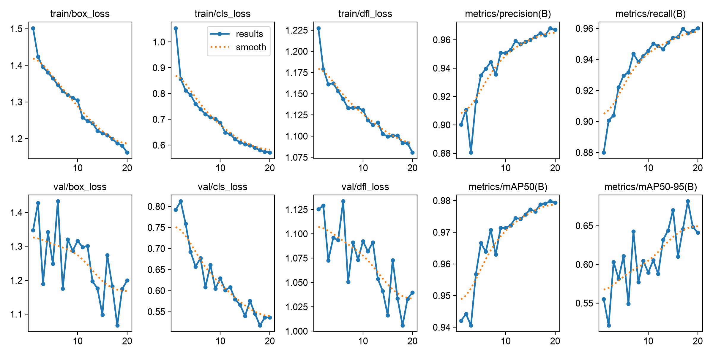
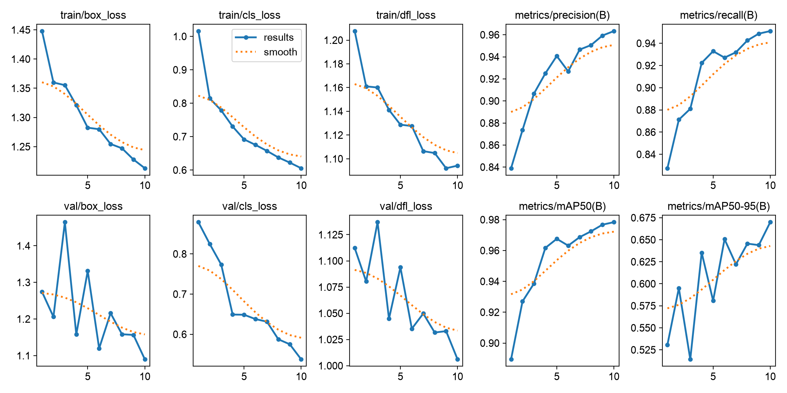

# Chromosome Detection with YOLOv8

ระบบตรวจนับโครโมโซมด้วย YOLOv8 - เทรนบน dataset 1,999 ภาพ

## ผลการเทรน

### เปรียบเทียบ v1 vs v2

| Metric | v1 (10 ep) | v2 (20 ep) |
|--------|:----------:|:----------:|
| mAP50 | 97.84% | 97.94% |
| mAP50-95 | 66.99% | 64.11% |
| Precision | 96.34% | 96.70% |
| Recall | 95.10% | 96.02% |

### ทดสอบกับ 100 ภาพจริง

| Metric | v1 | v2 |
|--------|:--:|:--:|
| MAE | 1.10 | 0.91 |
| ทายถูกเป๊ะ | 30% | 42% |
| ผิด ไม่เกิน ±1 | 72% | 79% |
| ผิด ไม่เกิน ±2 | 93% | 91% |

v2 ชนะโดยรวม

## Dataset

- 1,999 ภาพ
- 92,262 annotations
- Train 1,700 / Val 299

## กราฟการเทรน

### v2

### v1

## เทคโนโลยี

- YOLOv8 (ultralytics 8.4.176)
- PyTorch 2.14.1
- Python 3.11
- Apple Silicon (MPS)

## License

MIT
